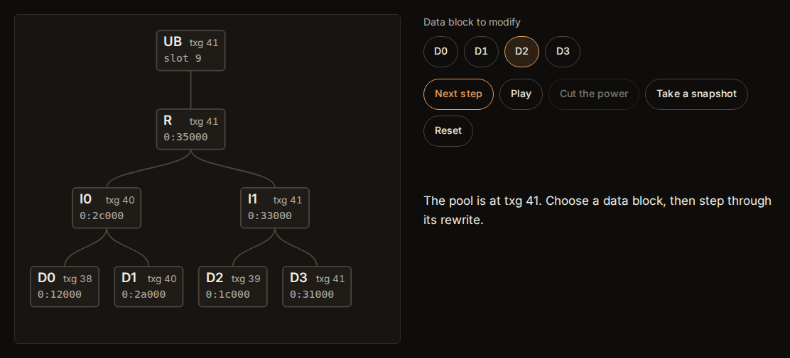

# Uberblok

An interactive museum of ZFS, on the web.

**Visit it: <https://uberblok.storagebits.workers.dev>**



## What it does

The visit goes room by room. Each technical room starts from a problem (silent corruption,
the write hole, consistency without `fsck`), then makes one engineering idea of the OpenZFS
source visible through an animation, sometimes interactive, with an annotated excerpt of the
real code. A history wing follows the project from the Sun Microsystems team to OpenZFS,
every fact sourced. The name comes from the uberblock, the root of the ZFS tree and the entry
point of a pool: it is the museum's hall.

The code analysed is OpenZFS `zfs-2.4.4`, commit
[`71a9f9578616a90c3c14bb59629fb4d31bfd68d1`](https://github.com/openzfs/zfs/tree/71a9f9578616a90c3c14bb59629fb4d31bfd68d1).

## Status

Version 1. The visit has fourteen stops:
the Hall (the uberblock and its ring, in 2D and 3D, and the map of the visit), the History wing
(a timeline from 2001 to today, every fact linked to its entry in `SOURCES.md`), eleven
technical rooms and the Engine room (the colophon: the commit, the stack, how the site was
built). The rooms: *The tree and the uberblock* (a block pointer tree, a write that copies its
path, the four beats of `vdev_config_sync`, the plug pulled at any of them, then the import; in
2D and 3D), *Copy-on-write, checksums and self-healing*, *Transaction groups* (open, quiescing,
syncing), *The vdevs* (the vdev tree, the allocation classes, I/O down mirrors, RAID-Z and dRAID;
in 2D and 3D), *RAID-Z* (the map of one block for any size, parity and width, and its
reconstruction), *Snapshots and clones* (birth txgs and deadlists), *The ARC* (MRU, MFU, ghost
lists and their balance), *Metaslabs and space maps*, *ZIL and SLOG* (the path of a synchronous
write, a crash, claim and replay), *send / receive* (a stream and the increment between two
snapshots) and *Compression, dedup, encryption*. Each figure runs a transcription of the code it
shows (`src/lib/`), tested on hand-checked cases. The measures of every page are in
[`BUILDLOG.md`](BUILDLOG.md).

## Getting started

Requirements: Node 22 (see `.nvmrc`; Astro 7 needs 22.22 or later), and Git for the checks.

```sh
nvm use
npm ci
npm run build      # astro check, then the static site in dist/
npm run preview    # serves dist/ on http://localhost:4321
npm test           # tests of the checkers and of every room's model
```

### Checking

Every excerpt in `ANALYSIS.md` must be byte-identical to the frozen source, and every link on
the built site must point to existing lines at the frozen commit:

```sh
git clone https://github.com/openzfs/zfs ../openzfs
node scripts/check-permalinks.mjs ../openzfs 71a9f9578616a90c3c14bb59629fb4d31bfd68d1 ANALYSIS.md
node scripts/check-permalinks.mjs ../openzfs 71a9f9578616a90c3c14bb59629fb4d31bfd68d1 $(find dist -name '*.html')
```

Every source reference on the built site must resolve to a row of `SOURCES.md`, and every
row must be cited (CI runs this); link liveness of the sources is checked by hand, since
archives and bot walls are flaky:

```sh
node scripts/check-sources.mjs SOURCES.md $(find dist -name '*.html')
node scripts/check-source-links.mjs SOURCES.md
```

Browser checks (captures, console errors, keyboard walk, reduced motion) run against a
preview with Playwright; captures go to `shots/`, which git ignores:

```sh
node scripts/verify.mjs http://127.0.0.1:4321 shots/<slice>   # every room, its figure replayed against its model
node scripts/audit.mjs http://127.0.0.1:4321 shots/audit       # the whole visit: axe in both themes, keyboard,
                                                               # previous/next, language switch, reduced motion
CHROME_PATH=<chromium> node scripts/lighthouse.mjs http://127.0.0.1:4321 shots/lh   # Lighthouse, every page
```

## Deploy

The site itself has one value in the code, the analytics token. Deployment is configured in GitHub and Cloudflare:

| Key | Kind | Where | Role |
|---|---|---|---|
| `PUBLIC_RELEASE` | repository variable | GitHub Actions | The deploy step runs only when it is `true`. |
| `CLOUDFLARE_API_TOKEN` | organization secret (`algotitanhq`) | GitHub Actions | API token with "Workers Scripts: Edit" on the one account that hosts the Worker; the deploy step asks Cloudflare for that account and masks its ID in the logs. |
| `CLOUDFLARE_ACCOUNT_ID` | organization variable (`algotitanhq`) | GitHub Actions | Not read by this workflow: a value from `vars` would show in clear in the logs. |
| `CF_WEB_ANALYTICS_TOKEN` | constant | `src/lib/analytics.ts` | Cloudflare Web Analytics site token (public). The beacon is built in only with `PUBLIC_RELEASE` on and a non-empty token (DECISIONS.md D18.2). |
| `wrangler.jsonc` | file | repository | Cloudflare Workers with static assets serving `dist/`; `preview_urls` is off. |

Everything goes through GitHub Actions (`.github/workflows/ci.yml`): tests, excerpt check,
build, permalink and source checks on the built site; branches stop there. The deploy step
(`wrangler deploy`) runs only on `main`, on a push or a manual run of the workflow, once
`PUBLIC_RELEASE` is `true`. Never add repository-level copies of the organization's keys: they
would override them. The site is deployed to Cloudflare Workers from `main`, at
<https://uberblok.storagebits.workers.dev>. `public/_headers` sets its security headers
(HSTS, a Content-Security-Policy, no framing); CI checks the policy against every inline script
of the build.

Notes on the team's own build machine: [`docs/dev.md`](docs/dev.md).

## Project layout

| Path | What it holds |
|---|---|
| `src/pages/{en,fr,es}/` | One file per page and language. |
| `src/lib/rooms.ts` | The visit: order, titles, localized slugs. |
| `src/components/` | The figures and the excerpt block. |
| `src/styles/tokens.css` | The design tokens. |
| `scripts/` | The checkers and the browser checks; their tests in `scripts/test/`. |
| [`ANALYSIS.md`](ANALYSIS.md) | The OpenZFS architecture and, for every room, the functions and structures that *are* the idea, with excerpts and permalinks to the frozen commit. The animations are derived from it, and the site reads its excerpts from it. |
| [`DECISIONS.md`](DECISIONS.md) | Every structural choice, with the alternatives set aside. |
| [`SOURCES.md`](SOURCES.md) | Every historical fact with its source, one row per claim; the History wing is built from it and CI checks the two match (`scripts/check-sources.mjs`). |
| [`BUILDLOG.md`](BUILDLOG.md) | One entry per slice, with the measures. |

## Licence and credits

- The site's own code is under the [MIT licence](LICENSE).
- The site's own texts and illustrations are under [CC BY 4.0](https://creativecommons.org/licenses/by/4.0/).
- The typefaces, Fraunces, Inter and Instrument Serif, are served with the site from their
  [Fontsource](https://fontsource.org) packages, under the
  [SIL Open Font License 1.1](https://openfontlicense.org), copyright of their respective
  project authors.
- The OpenZFS excerpts are short quotations of code under the
  [Common Development and Distribution License 1.0](https://opensource.org/licenses/CDDL-1.0),
  copyright of their respective authors (Sun Microsystems, Oracle, Delphix, Lawrence
  Livermore National Laboratory and the OpenZFS contributors, as stated in each file's
  header). Each excerpt links to its file and lines at the frozen commit. This repository
  does not redistribute OpenZFS files; the MIT licence does not cover them.

Uberblok is not affiliated with the OpenZFS project.
